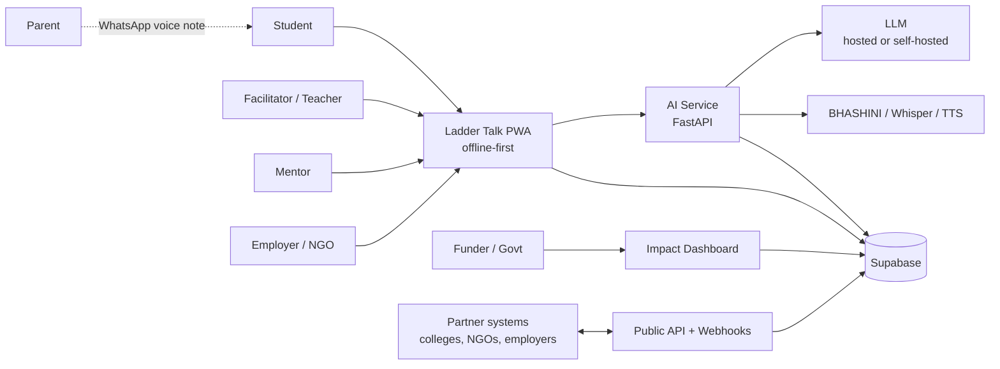
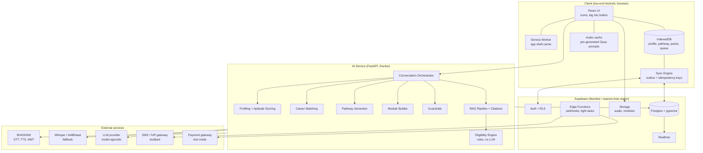
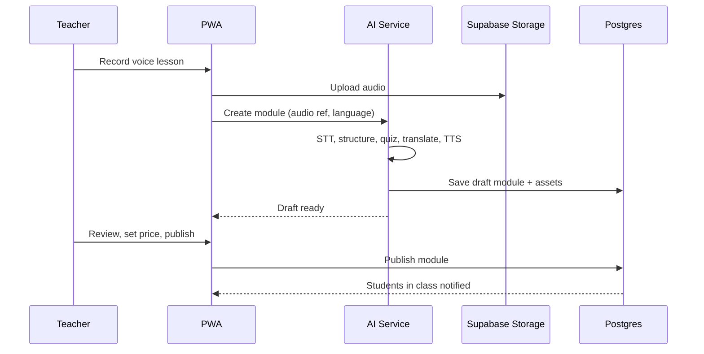
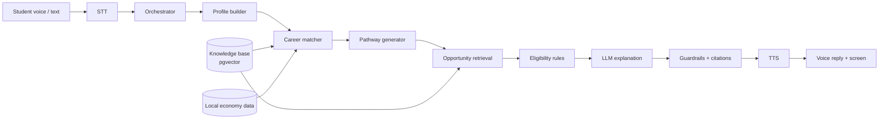
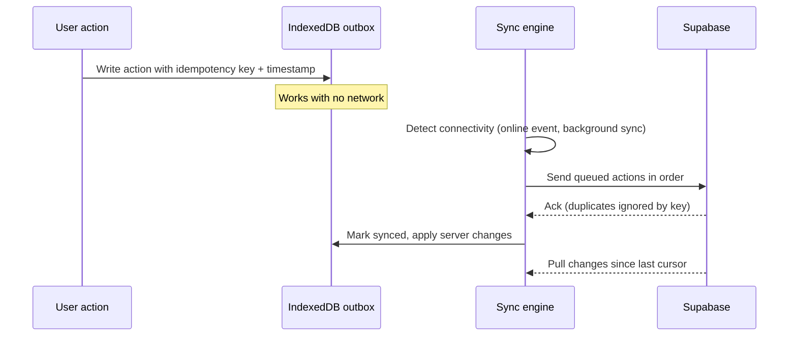
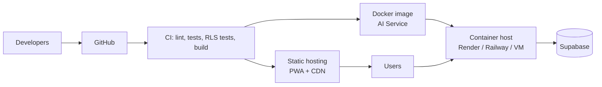

# Ladder Talk: System Architecture

> **Ladder Talk** is a voice-first, offline-capable AI platform that helps rural Indian students (Std 9 to graduation) discover what they are good at, learn what to do next, and reach scholarships, apprenticeships, mentors and employers. Village teachers act as facilitators, with one teacher supporting many students.

| | |
|---|---|
| **Status** | Hackathon prototype design (v0.1) |
| **Hackathon** | Citi Ada Lovelace Hackathon, "Reimagining Education & Economic Empowerment for Rural India" |
| **Licence (proposed)** | Apache 2.0 |
| **Last updated** | 16 October 2026 |

---

## Table of contents
1. [Goals and requirement mapping](#1-goals-and-requirement-mapping)
2. [Design principles](#2-design-principles)
3. [Users and roles](#3-users-and-roles)
4. [High-level architecture](#4-high-level-architecture)
5. [Component design](#5-component-design)
6. [AI architecture](#6-ai-architecture)
7. [Voice and language layer](#7-voice-and-language-layer)
8. [Offline-first and sync design](#8-offline-first-and-sync-design)
9. [Data architecture](#9-data-architecture)
10. [API and interoperability](#10-api-and-interoperability)
11. [Security, privacy and trust](#11-security-privacy-and-trust)
12. [Deployment and infrastructure](#12-deployment-and-infrastructure)
13. [Scalability and performance](#13-scalability-and-performance)
14. [Monetization architecture](#14-monetization-architecture)
15. [Impact measurement](#15-impact-measurement)
16. [Prototype scope and status](#16-prototype-scope-and-status)
17. [Risks and mitigations](#17-risks-and-mitigations)
18. [Repository structure](#18-repository-structure)
19. [Architecture decision records](#19-architecture-decision-records)
20. [Assumptions and open questions](#20-assumptions-and-open-questions)

---

## 1. Goals and requirement mapping

### 1.1 Product goals
- **Discover:** build a student's profile (interests, skills, goals, context) through a local-language voice or text conversation, then suggest careers, including non-STEM and vocational ones.
- **Learn:** generate a personal pathway showing what to learn next and which exams to prepare for, deliberately widening options beyond the popular careers.
- **Opportunity:** match students to scholarships, schemes, apprenticeships, mentors and employers, and explain why they qualify.
- **Facilitate:** let teachers spot talent, recommend students, and create and sell their own training modules.

### 1.2 Requirement traceability
| Requirement from the problem statement | How the architecture satisfies it | Section |
|---|---|---|
| Local language, voice input and output, simple UI for low-literacy users | Voice-first PWA, icon-driven UI, STT/TTS via BHASHINI with fallbacks, automatic language detection | 5.1, 7 |
| Low-end Android phones, offline and low-bandwidth sync | Lightweight PWA, IndexedDB local store, cached audio prompts, queued sync with idempotency | 8 |
| Facilitator mode, one teacher helping many students | Class model, teacher dashboard, bulk onboarding with join codes, recommendation workflow | 5.5, 9 |
| AI grounded in real data | RAG over a curated, dated knowledge base with citations, plus a deterministic eligibility engine | 6 |
| Open-source architecture, easily extendable | Open-source stack, self-hostable, model-agnostic AI layer, content-as-data for languages and careers | 2, 12, 19 |
| Meaningful intelligence | Profiling, career matching, eligibility checks, pathway generation, talent flagging | 6 |
| Multilingual and voice-enabled access | i18n framework, multilingual embeddings, STT/TTS/translation services | 7 |
| APIs and interoperability | Versioned REST API with OpenAPI, webhooks, partner API keys | 10 |

### 1.3 Out of scope
- Villages with **no internet connectivity at all**. The system is designed for intermittent connectivity.
- Real payment processing and real submission of government applications in the prototype (mocked and documented).

---

## 2. Design principles

1. **Voice first, text second.** No screen should require reading to proceed.
2. **Offline first.** Core flows must work with no signal. Network is an enhancement.
3. **Grounded, not guessed.** Facts about schemes and eligibility come from verified data and rules, never from the model's memory.
4. **Explain everything.** Each recommendation shows *why*, with a source and a last-verified date.
5. **Teachers multiply impact.** Design for one facilitator and many learners.
6. **Local relevance.** Rank options by what exists within reach of the student.
7. **Open and extensible.** New languages, careers, schemes and partners are added as data, not code.
8. **Privacy by design.** Many users are minors, so collect the minimum and require consent.
9. **Model-agnostic.** No hard dependency on a single AI vendor.

---

## 3. Users and roles

| Role | Description | Key capabilities |
|---|---|---|
| **Student** | Std 9 to graduation, possibly low literacy | Voice onboarding, aptitude games, career matches, pathway, opportunities, parent voice summary, talent passport |
| **Facilitator** | Teacher or NGO volunteer | Class dashboard, talent flags, recommendations, module creation, earnings |
| **Parent** (limited) | Influences the decision | Receives a voice summary in their language (no account needed in v1) |
| **Mentor** | Alumni or professional | Profile, availability, match requests |
| **Employer / NGO** | Supply side | Post apprenticeships, internships and micro-gigs, view verified talent |
| **Admin / Content curator** | Platform team | Curate the knowledge base, verify entries, manage partners |
| **Funder / Government** | CSR or state | Read-only impact dashboard |

---

## 4. High-level architecture

### 4.1 System context



### 4.2 Container view



---

## 5. Component design

### 5.1 Client: React PWA
| Concern | Choice | Notes |
|---|---|---|
| Framework | React + Vite (TypeScript) | Small bundle, fast load on weak devices |
| Installability | Web App Manifest + service worker (Workbox) | Installs from the browser, no store approval |
| Local storage | IndexedDB via Dexie | Profile, pathway, data pack, outbox queue |
| i18n | i18next, one JSON file per language | Adding a language is a translation file plus voice support |
| UI for low literacy | Large icons, photos, one action per screen, audio on every screen | Voice prompt plays automatically, with a replay button |
| Charts | Recharts | Dashboards only, lazy-loaded |
| Performance budget | Initial JS under about 200 KB gzipped, lazy-load teacher and dashboard routes | Verify with Lighthouse on a throttled profile |

**Key screens (student):** Language-free welcome (voice), Talk to me (Discover chat), Play (aptitude games), My careers, My ladder (pathway), Opportunities, Documents checklist, Share with parents, My passport.

**Key screens (facilitator):** My class, Student detail, Talent flags, Recommend, Create module, Earnings.

### 5.2 Supabase
| Service | Use |
|---|---|
| **Postgres** | Primary store for users, content, applications, modules, events |
| **pgvector** | Embeddings for the knowledge base and career profiles, in the same database |
| **Auth** | Email or OTP login, teacher join codes for class onboarding, JWT with role claims |
| **Row Level Security (RLS)** | Students access only their own rows, facilitators access only their classes, partners access only their own listings |
| **Storage** | Voice lessons, module assets, generated audio, with signed URLs |
| **Realtime** | Live updates on the facilitator dashboard |
| **Edge Functions** | Webhooks, notification triggers, lightweight glue |

Region: choose an India or nearest Asia region to keep latency low and keep children's data in India where possible.

### 5.3 AI Service (FastAPI)
A stateless Python service, containerised, holding all AI logic so it can be scaled and replaced independently. It exposes OpenAPI documentation automatically.

| Module | Responsibility |
|---|---|
| Conversation Orchestrator | Runs the Discover dialogue, detects language, manages state and turn limits |
| Profiling and Aptitude Scoring | Turns answers and game results into a structured profile (see 6.2) |
| Career Matching | Scores careers against the profile and the local economy (see 6.3) |
| RAG Pipeline | Retrieves verified entries and builds grounded answers with citations (see 6.4) |
| Eligibility Engine | Deterministic rule evaluation (see 6.5) |
| Pathway Generator | Builds the step-by-step ladder (see 6.6) |
| Module Builder | Voice lesson to structured module, quiz and translations (see 5.5) |
| Guardrails | Input and output checks, refusal and escalation paths (see 6.7) |

### 5.4 Opportunity and partner service
Manages scholarships, schemes, apprenticeships, internships, micro-gigs, mentors and employers. Partners onboard through the web app or the partner API. Every listing carries an owner, a source, a verification status and a last-verified date.

### 5.5 Facilitator and module service
- **Class management:** teacher creates a class and shares a **join code**, students join without individual onboarding effort.
- **Talent flags:** the system surfaces students with strong scores or early signs of disengagement. The teacher can accept or ignore a flag.
- **Recommendations:** the teacher recommends a student for an opportunity, which adds an endorsement to the student's passport.
- **Module creation:** the teacher records a voice lesson, then the pipeline runs: STT, structure into sections, generate a short quiz, translate to other languages, generate audio. The teacher reviews and publishes it as free, pay-per-module or subscription.



### 5.6 Impact dashboard
Aggregated, privacy-safe views for funders, NGOs and government: students profiled, pathways started, applications completed, apprenticeship matches, module usage, and income-outcome change. Only aggregated or consented data is shown, with small-group suppression.

### 5.7 Notification service (partial)
Deadline alerts and reminders through in-app notices and, in later phases, SMS or IVR. The gateway integration is stubbed in the prototype.

---

## 6. AI architecture

### 6.1 Overview
The system combines a **language model for conversation and explanation** with **retrieval over verified data** and **deterministic rules for eligibility**. The model never decides who is eligible, and never states a scheme fact without a retrieved source.



### 6.2 Profiling and aptitude (Discover)
- **Conversation:** a short, adaptive voice dialogue covering interests, favourite subjects, tasks they enjoy, family occupation, district, language, and goals. The orchestrator extracts structured fields (JSON schema) and asks follow-ups only for missing fields.
- **Aptitude through play:** two or three voice-guided mini-games or scenarios (for example, a customer overpays and the student decides what to do) produce scores for numeracy, empathy, mechanical sense and problem solving. These add signal for students with no academic records.
- **Output:** a profile vector (embedding of the narrative) plus structured features (interests, aptitude scores, constraints such as budget, location and class).
- **Caution:** aptitude scores are indicative, not diagnostic. The UI frames them as "things you might enjoy", and teachers can review them.

### 6.3 Career matching and local-economy mapping
For each candidate career:

```
score = w1 * semantic_similarity(profile, career)
      + w2 * aptitude_fit(aptitude_scores, career_requirements)
      + w3 * local_economy_fit(district, career)
      + w4 * accessibility(education_level, cost, distance)
      + w5 * widening_bonus(career_is_non_popular)
```
- **Local economy fit** uses a district dataset of employers, ITIs, cooperatives, mandis, health centres and MSME clusters, so each career can show "what exists near you".
- **Widening bonus** is deliberately applied so the top results are not only the popular careers. Results include at least some non-STEM and vocational options.
- Weights are configuration, tuned on a small set of test personas, and are visible to curators.
- Each recommendation is shown with its reasons ("matched because you like fixing machines and a diesel-pump workshop cluster is in your block").

A short **"day in the life"** narration for each career is generated from the curated career profile, not freely invented, and is spoken in the student's language.

### 6.4 Retrieval-augmented generation with citations
- **Corpus:** curated entries for schemes, scholarships, courses, exams, apprenticeships and careers, chunked and stored in pgvector.
- **Embeddings:** a multilingual model (for example BGE-M3 or multilingual-e5) so a Tamil or Hindi question retrieves English source data.
- **Retrieval:** hybrid search (vector similarity plus keyword and metadata filters such as state, class and category), then rerank.
- **Generation:** the prompt contains only the retrieved chunks. The model must answer from them and return **source IDs**.
- **Citation object returned to the UI:** `{entry_id, title, source_url, last_verified, confidence}`.
- **"I don't know" path:** if retrieval confidence is below a threshold, the assistant says it is not sure, suggests asking the teacher, and logs the gap for the curator.

### 6.5 Eligibility engine (no LLM)
- Rules are stored as structured data attached to each opportunity (for example, income ceiling, category, state, class range, gender, disability, marks threshold).
- The engine evaluates the student's profile and returns one of: **eligible**, **not eligible**, or **eligible if you provide X**, with the exact rule outcomes.
- It generates a **document checklist** (for example income certificate, caste certificate, bank account, Aadhaar-linked details) and the next step for each missing item.
- The LLM is used only to *rephrase* the structured result into simple spoken language. It cannot change the verdict.
- Unit tests cover each rule type and boundary values.

```json
{
  "opportunity_id": "sch_0042",
  "verdict": "eligible_if",
  "rules": [
    {"rule": "family_income_lte", "required": 250000, "student": 180000, "pass": true},
    {"rule": "class_between", "required": [9, 10], "student": 10, "pass": true},
    {"rule": "has_document", "required": "income_certificate", "student": false, "pass": false}
  ],
  "missing_documents": ["income_certificate"],
  "source": {"url": "https://example.gov.in/...", "last_verified": "2026-10-10"}
}
```
*(The values above are illustrative placeholders, not real scheme data.)*

### 6.6 Pathway generation
- Inputs: chosen career, current education level, language, time and cost constraints, local options.
- Output: an ordered ladder of steps, each with type (learn, practise, exam, apply, connect), estimated duration, cost, a resource link (DIKSHA, SWAYAM, Skill India, or a facilitator module) and a link to related opportunities.
- Pathways are generated from curated career templates and retrieved resources, then personalised by the model. Every external resource must exist in the knowledge base, so the model cannot invent links.
- The pathway is stored locally for offline use and re-planned when the student's progress changes.

### 6.7 Guardrails
| Risk | Control |
|---|---|
| Hallucinated schemes or links | Answers only from retrieved chunks, resource links validated against the knowledge base |
| Wrong eligibility | Deterministic engine decides, the model only explains |
| Unsafe or off-topic input | Input classifier and refusal, with an escalation message to the teacher for sensitive topics (distress, abuse) |
| Biased career steering (gender, caste, region) | Test personas across demographics, widening bonus, no use of caste or religion as a *matching feature* (category is used only for eligibility rules) |
| Over-promising incomes | Salary ranges shown as ranges with a source and date, with a plain-language caveat |
| Minors | Age-appropriate tone, no free-form web browsing, consent screens |

### 6.8 Model strategy
- **Model-agnostic interface:** one internal `LLMClient` abstraction, with provider adapters.
- **Prototype:** a hosted model for best Tamil and Hindi quality, with the prompts and schemas in the repository.
- **Self-hosted path:** an open model (for example Llama or Qwen) served via Ollama or vLLM, documented so partners can run without a paid API.
- **Evaluation:** a small test set of personas and questions per language, checked for groundedness (every claim has a citation), correctness of eligibility, and language quality.

---

## 7. Voice and language layer

| Capability | Primary | Fallback |
|---|---|---|
| Speech to text | BHASHINI ASR | Whisper, AI4Bharat Indic models |
| Text to speech | BHASHINI TTS | AI4Bharat Indic TTS, browser SpeechSynthesis |
| Translation | BHASHINI NMT | Open Indic translation model |
| Language identification | Whisper language ID or a small classifier on the first utterance | Manual choice by icon (flag-free, voice sample buttons) |

**Notes**
- A **voice adapter** interface hides the provider, so swapping or adding services doesn't touch the app logic.
- **Common prompts** (greetings, navigation, standard questions) are pre-generated, compressed (Opus) and cached on the device, so the core flow speaks offline and costs nothing per use.
- **Text fallback** is always available. Dialect accuracy will not be perfect, so the UI lets users repeat, correct by tapping, or ask a facilitator.
- **Languages in the prototype:** English plus one or two regional languages (to be fixed by the team). Each added language needs UI strings, STT/TTS support, and translated content, and is therefore added as data.
- BHASHINI access requires registration, and availability and quotas should be confirmed early.

---

## 8. Offline-first and sync design

### 8.1 What works offline
| Works offline | Needs connectivity |
|---|---|
| App shell and navigation | First-time login and language pack download |
| Cached voice prompts and screens | New AI conversation turns with the LLM |
| Saved profile, career matches and pathway | Fresh retrieval of new schemes |
| Data pack of schemes, careers and local economy for the pilot district | Module purchase and publishing |
| Eligibility engine on the cached pack (rules run on the device) | Impact dashboard |
| Downloaded modules and quizzes | Realtime teacher updates |
| Recording audio and queueing it | Transcription of queued audio |

Running the eligibility rules on the device is deliberate, because it is deterministic and small, so a student can check eligibility with no signal.

### 8.2 Data pack
A compressed, versioned bundle per district and language containing opportunities and rules, career profiles, local-economy data, and cached citations. The client checks the version on connect and downloads deltas.

### 8.3 Sync engine

- **Outbox pattern:** every mutation is stored locally first and sent later.
- **Idempotency keys** prevent duplicate applications or recommendations after retries.
- **Conflict policy:** last-write-wins by server-validated timestamp for simple fields, and append-only for events (endorsements, progress), which cannot conflict.
- **Bandwidth saving:** delta sync, gzip or Brotli, small JSON payloads, audio uploaded in compressed chunks and resumable.
- **Sync libraries:** the team may use a purpose-built layer (for example PowerSync or RxDB with Supabase) instead of a custom engine, if time is short.

### 8.4 Known limitation
Fully on-device speech recognition is hard on low-end phones. The prototype records audio offline and transcribes it on reconnect, while the icon and text flow works fully offline. Compact on-device models are a roadmap item.

### 8.5 Feature-phone fallback (roadmap)
An IVR or SMS channel backed by the same AI and eligibility services gives students without smartphones access to scheme and deadline information.

---

## 9. Data architecture

### 9.1 Entity overview
```mermaid
erDiagram
    PROFILE ||--o| STUDENT : is
    PROFILE ||--o| FACILITATOR : is
    FACILITATOR ||--o{ CLASS : runs
    CLASS ||--o{ CLASS_MEMBER : has
    STUDENT ||--o{ CLASS_MEMBER : joins
    STUDENT ||--o{ APTITUDE_RESULT : takes
    STUDENT ||--o{ PATHWAY : follows
    PATHWAY ||--o{ PATHWAY_STEP : contains
    STUDENT ||--o{ APPLICATION : starts
    OPPORTUNITY ||--o{ APPLICATION : receives
    OPPORTUNITY ||--o{ ELIGIBILITY_RULE : has
    OPPORTUNITY ||--o{ KB_CHUNK : described_by
    CAREER ||--o{ KB_CHUNK : described_by
    CAREER ||--o{ LOCAL_ECONOMY_LINK : located_in
    FACILITATOR ||--o{ MODULE : creates
    MODULE ||--o{ ENROLMENT : has
    STUDENT ||--o{ ENROLMENT : takes
    STUDENT ||--o{ CREDENTIAL : earns
    FACILITATOR ||--o{ RECOMMENDATION : writes
    STUDENT ||--o{ RECOMMENDATION : receives
    PROFILE ||--o{ CONSENT : gives
```

### 9.2 Core tables (summary)
| Table | Purpose | Key fields |
|---|---|---|
| `profiles` | Base user record linked to Supabase Auth | id, role, language, district, state |
| `students` | Student details | profile_id, class_level, interests (jsonb), family_income_band, category (for eligibility only), consent_id |
| `facilitators` | Teacher details | profile_id, institution, verified |
| `classes`, `class_members` | Facilitator groups | join_code, facilitator_id, student_id |
| `aptitude_results` | Game and scenario outputs | student_id, dimension, score, taken_at |
| `careers` | Curated career profiles | id, title (multilingual), requirements, income_range, source, last_verified |
| `local_economy` | District employers, ITIs, cooperatives, markets | district, type, name, careers[], source |
| `opportunities` | Schemes, scholarships, apprenticeships, courses, exams, gigs | id, type, owner, source_url, deadline, last_verified, verified_by |
| `eligibility_rules` | Structured rules per opportunity | opportunity_id, rule_type, params (jsonb) |
| `kb_chunks` | Retrieval chunks | entry_id, language, text, embedding (vector), metadata (jsonb) |
| `pathways`, `pathway_steps` | Personal ladders | student_id, career_id, step type, status, resource_id |
| `applications` | Application tracking | student_id, opportunity_id, status, documents (jsonb) |
| `recommendations` | Teacher endorsements | facilitator_id, student_id, opportunity_id, note |
| `modules`, `enrolments` | Teacher content and access | facilitator_id, language, price_model, assets, status |
| `credentials` | Talent passport entries | student_id, skill, issuer, evidence, verified |
| `consents` | Consent records | profile_id, scope, given_by (parent or guardian), timestamp |
| `sync_log`, `audit_log` | Idempotency and traceability | idempotency_key, actor, action, at |

### 9.3 Illustrative schema excerpts
```sql
-- Knowledge-base chunks with embeddings (pgvector)
create extension if not exists vector;

create table kb_chunks (
  id uuid primary key default gen_random_uuid(),
  entry_id uuid not null,
  entry_type text not null check (entry_type in
    ('scheme','scholarship','course','exam','apprenticeship','career')),
  language text not null,
  content text not null,
  embedding vector(1024),            -- dimension depends on the chosen embedding model
  metadata jsonb not null default '{}',   -- state, class range, category tags
  source_url text not null,
  last_verified date not null
);

create index on kb_chunks using hnsw (embedding vector_cosine_ops);

-- Example Row Level Security: a student reads only their own pathways
alter table pathways enable row level security;

create policy student_reads_own_pathways on pathways
  for select using (student_id = auth.uid());

-- A facilitator reads pathways of students in their classes
create policy facilitator_reads_class_pathways on pathways
  for select using (
    exists (
      select 1
      from class_members cm
      join classes c on c.id = cm.class_id
      where cm.student_id = pathways.student_id
        and c.facilitator_id = auth.uid()
    )
  );
```
The schema above is a design sketch and should be validated against the final tables before use.

### 9.4 Content governance
The knowledge base is the product's most valuable asset and its main accuracy risk.
- **Curator workflow:** draft entry, source link and date, second-person verification, publish.
- **Freshness:** entries show last-verified dates, and entries past a review window are flagged and de-prioritised.
- **Gap logging:** unanswered questions feed a curator backlog.
- **Provenance:** every entry stores its source, so any answer can be traced.
- **Seed data for the prototype:** roughly 40 to 60 entries and 40 or more career profiles for one or two pilot districts, verified by the team against official sources (DIKSHA, SWAYAM, Skill India, NAPS, National Scholarship Portal, AISHE).

---

## 10. API and interoperability

### 10.1 Principles
- REST with **OpenAPI 3** documentation generated by FastAPI, versioned under `/v1`.
- JSON payloads, consistent error format, pagination, and idempotency keys on write endpoints.
- Authentication through Supabase JWTs for users, and **scoped API keys** for partners.
- Webhooks for events such as `application.started`, `recommendation.created` and `module.published`.

### 10.2 Example endpoints
| Method | Path | Purpose |
|---|---|---|
| POST | `/v1/conversations/{id}/turn` | Send a student utterance, receive a reply and structured profile updates |
| GET | `/v1/students/{id}/careers` | Ranked career matches with reasons and local-economy evidence |
| POST | `/v1/students/{id}/pathway` | Generate or refresh the pathway |
| GET | `/v1/students/{id}/opportunities` | Matched opportunities with eligibility verdicts |
| POST | `/v1/eligibility/evaluate` | Evaluate a profile against an opportunity (also runs client-side) |
| POST | `/v1/modules` | Create a module from a voice lesson |
| POST | `/v1/recommendations` | Facilitator recommends a student |
| GET | `/v1/partner/opportunities` | Partner lists and manages its own listings |
| POST | `/v1/partner/webhooks` | Register webhook endpoints |
| GET | `/v1/impact/summary` | Aggregated metrics for funders |
| GET | `/v1/datapack/{district}/{language}` | Versioned offline data pack |

### 10.3 Integration approach
| Partner type | Integration |
|---|---|
| Colleges and institutes | Course and admission listings via partner API, recommendation webhooks |
| Employers and NGOs | Listings API, verified-talent search with student consent |
| Government portals | Prototype uses curated data. Future integration targets listed portals (National Scholarship Portal, NAPS, Skill India, DIKSHA, SWAYAM) subject to their available interfaces and approvals |
| Language services | Voice adapter for BHASHINI and alternatives |

Real government API availability and terms must be checked before promising live integration. The prototype does not claim it.

---

## 11. Security, privacy and trust

### 11.1 Privacy and children's data
- Many users are minors. Under India's **Digital Personal Data Protection Act, 2023**, processing a child's data requires verifiable consent from a parent or guardian, and there are limits on tracking and targeted advertising aimed at children. Legal review is needed before any real deployment.
- **Consent screen** at onboarding, explained by voice, with a record in `consents`. In a school setting, the facilitator can collect guardian consent on the student's behalf only if the school's process allows it.
- **Data minimisation:** collect only what eligibility and matching need. Store family-income band, not exact figures, where possible.
- **Sensitive attributes** (category, disability) are used only for eligibility rules and never as career-matching features.
- **No advertising and no sale of student data.** Employer access to student profiles requires the student's (and guardian's) opt-in.
- **Data residency:** host in an India region where available.
- **Right to delete:** a delete-account flow that removes personal data and queued items.

### 11.2 Security controls
| Area | Control |
|---|---|
| Authentication | Supabase Auth, short-lived JWTs, role claims |
| Authorisation | Row Level Security on every table, with automated policy tests |
| Transport and storage | TLS everywhere, encrypted storage, signed URLs for audio and files |
| Secrets | Environment variables, never in the client bundle or repository |
| API abuse | Rate limiting and per-key quotas on public and partner APIs |
| Input handling | Schema validation on all endpoints, upload type and size limits |
| Audit | Append-only audit log for recommendations, applications and admin changes |
| Device security | Local data cleared on logout, optional PIN, because phones may be shared |
| Supply chain | Dependency scanning in CI, pinned versions |

### 11.3 AI-specific safety
Guardrails in 6.7, plus prompt-injection defences (retrieved text is treated as data, not instructions), logging of AI inputs and outputs with PII minimised, and a human escalation route to the facilitator.

---

## 12. Deployment and infrastructure



| Concern | Prototype | Production direction |
|---|---|---|
| Frontend | Static hosting with CDN | Same, with regional edge caching |
| AI Service | Single container | Horizontally scaled containers behind a load balancer |
| Database | Supabase managed project | Supabase paid tier or **self-hosted Supabase** in an India region |
| LLM | Hosted API | Self-hosted open model for partners who need it |
| Config | `.env` files, `docker-compose` | Secrets manager |
| Reproducibility | `docker-compose up` brings up the AI service, with a documented Supabase setup (or local Supabase via its CLI) | Helm or equivalent |

CI runs unit tests (eligibility rules and boundaries), RLS policy tests, API contract tests against the OpenAPI schema, and a Lighthouse budget check for the PWA.

---

## 13. Scalability and performance

| Dimension | Approach |
|---|---|
| 10 to 10,000 users | Stateless AI service scales horizontally. Postgres with proper indexes (HNSW for vectors, B-tree for filters) handles this range comfortably. |
| Beyond that | Read replicas, caching of retrieval results per district and language, queue-based processing for module building and bulk transcription |
| Expensive AI calls | Cache pre-generated prompts, cache common retrieval answers, limit conversation turns, use smaller models for classification and larger ones only for generation |
| Many regions and languages | Content and strings are data. A district pack and a language pack are added without code changes |
| Low-end devices | Small bundle, lazy routes, compressed audio, no heavy client-side ML in v1 |
| Observability | Structured logs, basic metrics (latency, error rate, STT failure rate, retrieval confidence), and a simple dashboard |

Scaling claims in the pitch should be backed by a basic load test of the AI service before the demo.

---

## 14. Monetization architecture

| Stream | Payer | Technical support |
|---|---|---|
| **Module marketplace** | Students or parents | Teacher sets free, per-module or subscription pricing. The platform takes a commission. `modules`, `enrolments` and a payments adapter (test mode in the prototype) |
| **Talent pipeline** | NGOs and employers | Paid listing tiers and consented verified-talent search through the partner API |
| **CSR programmes** | Corporates | Sponsored scholarships and cohorts, with district impact reports from the impact dashboard |
| **Government licensing** | State or district | Multi-tenant district configuration, data packs and dashboards |

Design implications: a payments adapter with idempotent webhooks, tenant (district or organisation) scoping in the data model, and revenue-share records for facilitators. No payment is processed in the prototype.

---

## 15. Impact measurement

| Metric | Source | Why it matters |
|---|---|---|
| Students profiled and given a pathway | `students`, `pathways` | Reach |
| Applications started and completed | `applications` | Real access to opportunity |
| Apprenticeship and internship matches per 100 students | `applications`, `opportunities` | Livelihood link |
| Modules published and facilitator earnings | `modules`, `enrolments` | Sustainability |
| Change in expected or actual income at 6 and 12 months | Follow-up check-ins (voice or SMS) with consent | The core livelihood outcome |

Income outcomes rely on self-reported follow-ups, so the dashboard labels them as self-reported and shows response rates. Aggregates for small groups are suppressed to protect privacy.

---

## 16. Prototype scope and status

| Capability | Prototype target | Notes |
|---|---|---|
| Voice and text Discover in 2 languages | **Build** | Text fallback always present |
| Aptitude mini-games (2 or 3) | **Build** | Indicative scores only |
| Career matching with local-economy fit | **Build** | One or two pilot districts |
| Pathway generator | **Build** | From curated templates and the knowledge base |
| RAG with citations and "I don't know" | **Build** | About 40 to 60 verified entries |
| Eligibility engine and document checklist | **Build** | Runs client-side and server-side |
| Parent voice summary | **Build** | Shareable audio |
| Offline mode and queued sync | **Build** | Core flows; recorded audio transcribed on reconnect |
| Facilitator dashboard and recommendations | **Build** | |
| Teacher voice-to-module creator | **Build (basic)** | Quiz and translation if time allows |
| Talent passport | **Build (basic)** | Endorsements and credentials list |
| Impact dashboard | **Build (basic)** | Seeded and live aggregate data |
| Public API with OpenAPI docs | **Build** | Generated by FastAPI |
| Payments | **Mock** | Test-mode flow only |
| Real application submission to government portals | **Mock** | Pre-filled summary and document checklist only |
| SMS and IVR channel | **Roadmap / stub** | Clearly labelled partial |
| Peer-to-peer device sync | **Roadmap** | |
| On-device speech models | **Roadmap** | |

---

## 17. Risks and mitigations

| Risk | Likelihood | Impact | Mitigation |
|---|---|---|---|
| Voice accuracy poor on rural dialects | High | High | BHASHINI with Whisper fallback, text and icon fallback, test with real voices early, limit demo languages |
| BHASHINI access or quota delays | Medium | High | Register now, keep the fallback adapters working from day one |
| LLM hallucination | Medium | High | RAG with citations, deterministic eligibility, "I don't know" path |
| Knowledge-base inaccuracy or staleness | Medium | High | Source and date on every entry, verification workflow, freshness flags |
| Offline sync bugs and duplicates | Medium | Medium | Outbox with idempotency keys, append-only events, sync tests |
| Row Level Security misconfiguration | Medium | High | Automated policy tests, review before demo |
| Supabase free-tier limits or project pausing | Medium | Medium | Verify current limits, keep the project active, take a local Supabase fallback for the demo |
| Children's data compliance | Medium | High | Consent flow, data minimisation, legal review before any real deployment |
| Scope too large for the timeline | High | High | Strict must-have list (section 16), mock the rest, label roadmap items honestly |
| Bias in career steering | Medium | Medium | Widening bonus, demographic persona tests, no sensitive attributes as match features |

---

## 18. Repository structure

```
ladder-talk/
├── README.md
├── ARCHITECTURE.md              # this document (or docs/architecture.md)
├── LICENSE
├── docker-compose.yml
├── .env.example
├── apps/
│   └── web/                     # React PWA
│       ├── src/
│       │   ├── features/        # discover, pathway, opportunities, facilitator, passport
│       │   ├── offline/         # IndexedDB schema, sync engine, data pack loader
│       │   ├── voice/           # recorder, player, audio cache
│       │   ├── i18n/            # one JSON file per language
│       │   └── eligibility/     # shared rule evaluator (client-side)
│       └── public/              # manifest, icons, cached prompts
├── services/
│   └── ai/                      # FastAPI service
│       ├── app/
│       │   ├── api/             # versioned routers, OpenAPI
│       │   ├── orchestrator/
│       │   ├── profiling/
│       │   ├── matching/
│       │   ├── rag/
│       │   ├── eligibility/
│       │   ├── pathway/
│       │   ├── modules/
│       │   ├── guardrails/
│       │   └── adapters/        # llm/, voice/ (bhashini, whisper), translation/
│       └── tests/
├── supabase/
│   ├── migrations/              # schema, RLS policies, pgvector setup
│   ├── seed/                    # curated knowledge base and local-economy data
│   └── tests/                   # RLS policy tests
├── data/
│   ├── sources.md               # where each entry came from
│   └── schemas/                 # JSON schemas for content entries
└── docs/
    ├── api.md
    ├── content-guide.md         # how to add a language, career, scheme or district
    └── adr/                     # architecture decision records
```

---

## 19. Architecture decision records

| # | Decision | Rationale | Alternatives considered | Trade-off |
|---|---|---|---|---|
| ADR-1 | PWA instead of a native app | One codebase, instant updates, installs without a store, light on weak phones | Flutter, native Android | Less access to some device features |
| ADR-2 | Supabase for data, auth, storage and vectors | Fewer moving parts for a small team, RLS for per-role access, pgvector keeps retrieval in one database, open source and self-hostable | Self-managed Postgres plus a separate vector store and custom auth | Online-first, so offline sync must be built separately |
| ADR-3 | Separate FastAPI AI service | Python AI ecosystem, auto-generated OpenAPI, independent scaling | Supabase Edge Functions only | One more service to deploy |
| ADR-4 | Deterministic eligibility engine, LLM only explains | Correctness and auditability for high-stakes decisions | LLM-judged eligibility | Rules must be authored and maintained |
| ADR-5 | RAG with mandatory citations over fine-tuning | Updatable without retraining, traceable, cheaper | Fine-tuned model | Quality depends on retrieval and content curation |
| ADR-6 | Model-agnostic LLM and voice adapters | Avoid lock-in, allow self-hosting, switch for cost or quality | Single vendor | Extra adapter code and testing |
| ADR-7 | Outbox pattern with idempotency keys for sync | Simple, robust, works with intermittent connectivity | CRDTs, full replication | Last-write-wins is limited for complex edits |
| ADR-8 | Eligibility rules run on the client as well as the server | Works with no signal, small deterministic logic | Server-only evaluation | Rules must be kept in sync across both |
| ADR-9 | Content, languages and districts are data, not code | Easy extension by non-developers and partners | Hard-coded content | Needs a curator workflow and schemas |
| ADR-10 | Mock payments and government submissions in the prototype | Avoid compliance and integration risk, still shows the model | Real integration | Cannot demonstrate live transactions |

---

## 20. Assumptions and open questions

**Assumptions**
- The prototype targets one or two pilot districts and one or two regional languages plus English.
- A hosted LLM is acceptable for the demo, with the self-hosted path documented.
- Curated data is verified manually by the team against official sources.

**Open questions to resolve**
1. Which pilot district(s) and languages will the demo use?
2. Is BHASHINI access approved, and what are its quotas?
3. Does the Google Form or any later round require a prototype link, repository or video?
4. Which Supabase plan and region will be used, and are the current free-tier limits sufficient?
5. Which sync approach will the team use: custom outbox or a library such as PowerSync or RxDB?
6. Who on the team owns content curation and verification?
7. What legal review is needed on consent and children's data before any pilot with real students?

---

*This document describes the intended design. Items marked mock, stub or roadmap in section 16 are not part of the first prototype, and the pitch should describe them that way.*
